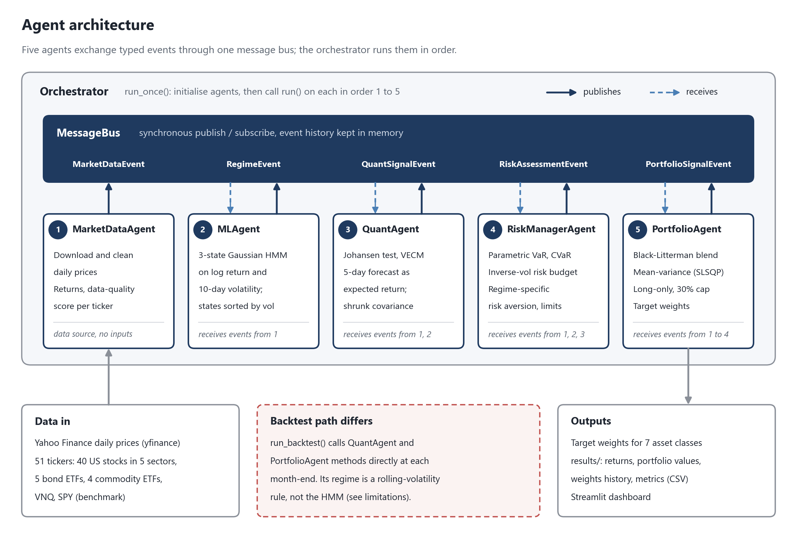
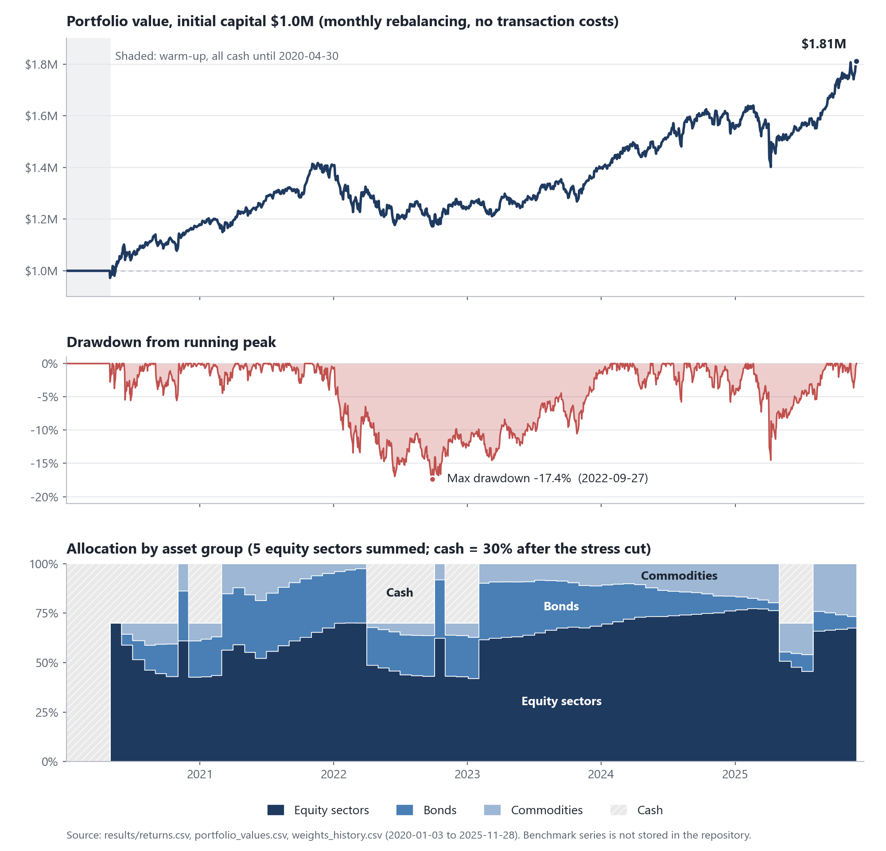

# Multi-Agent Regime Portfolio

*An event-driven pipeline of five agents (HMM regime detection, VECM return forecasts, Black-Litterman / mean-variance allocation) with a monthly-rebalanced multi-asset backtest over 2020-2025.*

김재하 (Jaeha Kim) · [github.com/summerjinhere](https://github.com/summerjinhere)



## 개요

미국 주식 40종목(5개 섹터), 채권 ETF 5종, 원자재 ETF 4종을 7개 자산군(섹터 5 + 채권 + 원자재)으로 묶어 월 단위로 배분하는 연구용 프로젝트다. 데이터 수집, 레짐 탐지, 기대수익률 추정, 리스크 평가, 비중 최적화를 각각 하나의 에이전트로 분리하고, 에이전트끼리는 메시지 버스에 이벤트를 발행·구독하는 방식으로만 정보를 주고받게 했다.

이 저장소에서 확인할 수 있는 것은 세 가지다.

- 에이전트 5개와 pub/sub 메시지 버스로 구성한 파이프라인 코드
- 2020-01-03부터 2025-11-28까지의 백테스트 산출물(`results/`의 CSV 4개)
- 백테스트를 다시 돌려 성과와 통계 검정을 보여 주는 Streamlit 대시보드

백테스트 결과는 검증된 투자 성과가 아니다. 특히 백테스트 루프는 위 그림의 에이전트 파이프라인과 다른 경로로 동작하며 HMM을 쓰지 않는다. 자세한 내용은 [한계와 다음 단계](#한계와-다음-단계)에 적었다.

## 아키텍처

`Orchestrator.run_once()`가 에이전트를 1번부터 5번까지 순서대로 실행한다. 각 에이전트는 `BaseAgent`를 상속하고, 실행이 끝나면 결과를 이벤트로 발행한다. `MessageBus`는 동기식 pub/sub이라 발행 즉시 구독자의 `on_event`가 호출되고, 뒤 순서의 에이전트는 그렇게 받아 둔 이벤트를 입력으로 쓴다.

| 순서 | 에이전트 | 하는 일 | 구독 이벤트 | 발행 이벤트 |
|---|---|---|---|---|
| 1 | `MarketDataAgent` | Yahoo Finance 일별 가격 다운로드, 결측 처리, 수익률 계산 | 없음 | `MarketDataEvent` |
| 2 | `MLAgent` | 3-state Gaussian HMM으로 레짐 추정 | MarketData | `RegimeEvent` |
| 3 | `QuantAgent` | Johansen 검정 후 VECM 예측으로 기대수익률과 공분산 산출 | MarketData, Regime | `QuantSignalEvent` |
| 4 | `RiskManagerAgent` | VaR/CVaR, 역변동성 리스크 예산, 레짐별 위험회피계수 | MarketData, Regime, QuantSignal | `RiskAssessmentEvent` |
| 5 | `PortfolioAgent` | Black-Litterman 결합 후 평균-분산 최적화로 목표 비중 산출 | 위 네 이벤트 | `PortfolioSignalEvent` |

`Orchestrator.run_backtest()`는 이 경로를 그대로 반복하지 않는다. 매월 마지막 거래일에 `QuantAgent.calculate_signal()`과 `PortfolioAgent.calculate_weights()`를 직접 호출하고, 레짐은 아래에 적은 변동성 규칙으로 정한다. `MLAgent`와 `RiskManagerAgent`는 백테스트 루프에서 실행되지 않는다.

## 방법론

구현된 내용만 적는다. 수치는 모두 코드의 기본값이다.

**레짐 (HMM, `agents/ml_agent.py`)** 전 종목 가격의 단순평균을 시장 대용치로 삼아 일별 로그수익률과 10일 이동 변동성을 특징으로 만들고, `hmmlearn`의 3-state Gaussian HMM(full covariance)을 적합한다. 상태 번호는 수익률 변동성이 낮은 순으로 다시 매겨 0 = Bull/LowVol, 1 = Transition, 2 = Bear/HighVol로 부른다. 실행할 때마다 전체 표본에 적합하고 Viterbi 경로의 마지막 값을 현재 레짐으로 쓴다.

**레짐 (백테스트 루프, `orchestrator.py`)** 직전 60거래일 종목별 변동성의 평균(연율)을 10%, 15%, 20%, 30% 경계로 나눈 5단계 규칙이다. 새 단계가 나와도 현재 단계가 10일 이상 유지된 뒤에만 바뀐다. 이 값은 위험회피계수(γ = 2 + 레짐)와 아래의 스트레스 축소에만 쓰인다.

**기대수익률 (VECM, `agents/quant_agent.py`)** 7개 자산군의 로그가격에 Johansen trace 검정(95% 임계값)을 적용해 공적분 rank를 정한다. rank가 1 이상이면 VECM(차분 시차 1)을 적합해 5거래일 뒤 예측값을 연율 기대수익률로 바꾸고 잔차 공분산을 쓴다. 공적분이 없으면 표본 평균과 표본 공분산으로 대체한다. 추정 구간은 `run_once`에서 최근 252거래일, 백테스트에서 2020년 1월부터 리밸런싱 전날까지의 누적 구간이다. 공분산은 대각행렬 쪽으로 고정 강도 0.2만큼 축소한다. 코드와 주석은 이 모형을 MS-VECM이라 부르지만 레짐별로 VECM 파라미터가 전환되는 추정은 없다. `run_once` 경로에서 HMM 레짐에 따라 기대수익률에 1.2/1.0/0.8배, 공분산에 0.8/1.0/1.2배를 곱하는 것이 레짐 반영의 전부다.

**리스크 예산 (`agents/risk_manager_agent.py`)** 동일가중 포트폴리오의 정규분포 가정 VaR/CVaR(95%), 역변동성 비중으로 계산한 리스크 예산, 변동성이 큰 자산일수록 낮아지는 포지션 한도, 레짐별 위험회피계수(2.0/3.5/6.0)를 `RiskAssessmentEvent`로 발행한다. 이 가운데 `PortfolioAgent`가 실제로 쓰는 값은 위험회피계수뿐이다.

**비중 최적화 (`agents/portfolio_agent.py`)** 동일가중을 시장 비중으로 가정한 균형수익률(δ = 2.5)에 모형 기대수익률을 절대 견해로 결합한다(τ = 0.05, Ω = τ·diag(Σ)). 이어서 wᵀμ − (γ/2)·wᵀΣw를 최대화한다. 제약은 비중 합 1, 공매도 없음, 자산군당 30% 상한이며 SLSQP로 푼다. 백테스트에서는 회전율을 줄이려고 기존 비중 80%와 새 비중 20%를 섞는다. SPY의 21일 변동성이 연 35%를 넘거나 레짐이 4이면 모든 비중에 0.7을 곱해 30%를 현금으로 둔다.

**통계 검증 (`analysis/statistics.py`)** 세 함수가 있고 대시보드의 Statistical Validation 화면에서만 호출된다.

- `run_ols`: 전략 일수익률을 벤치마크에 회귀하고 Newey-West HAC 표준오차로 alpha와 beta의 t값을 구한다. 시차는 `int(4·(n/100)^(2/9))`이다.
- `run_rolling_ols`: 252일 이동 회귀로 alpha와 beta의 시간 변화를 본다.
- `run_bootstrap`: 일수익률을 i.i.d.로 1,000회 복원추출해 Sharpe(무위험수익률 0)의 95% 구간과 P(Sharpe ≤ 0)을 계산한다. 블록 부트스트랩이 아니어서 자기상관은 반영하지 않는다.

Deflated Sharpe Ratio(DSR)는 현재 트리에 구현되어 있지 않다.

## 결과

아래 수치는 저장소에 커밋된 `results/` 파일에서 나온 것이다. `metrics.csv`의 전략 지표는 `returns.csv`로 다시 계산해 일치함을 확인했다(`portfolio_values.csv`와 누적수익률로 만든 가치의 차이는 1e-7달러 미만). 백테스트를 새로 돌린 값은 아니다.



| 지표 | 값 | 출처와 계산 방식 |
|---|---|---|
| 기간 | 2020-01-03 ~ 2025-11-28, 1,485거래일 | `returns.csv` |
| 첫 포지션 | 2020-05-01 (그 전 82거래일은 현금, 수익률 0) | `returns.csv`, `weights_history.csv` |
| 누적수익률 | +81.1% ($1.00M → $1.81M) | `metrics.csv`, 재계산 일치 |
| CAGR | 10.60% | 거래일 수/252를 연수로 사용. 첫 포지션 이후 1,403거래일만 보면 11.26%(재계산) |
| 연환산 변동성 | 11.47% | 일수익률 표준편차 × √252 |
| Sharpe | 0.49 | (CAGR − 5%) / 변동성. 무위험수익률은 전 기간 5% 고정 |
| Sharpe (무위험수익률 0) | 0.94 | 재계산: 일평균/표준편차 × √252 |
| Sortino | 0.65 | (CAGR − 5%) / 음(−)의 수익률 변동성 |
| 최대 낙폭 | −17.35% (고점 2021-11-19, 저점 2022-09-27) | 재계산 일치 |
| Beta / Alpha (SPY 대비) | 0.40 / 연 1.60% | `metrics.csv`만 있음. alpha는 CAGR 기준 CAPM 식 |
| SPY CAGR / Sharpe | 15.09% / 0.48 | `metrics.csv`만 있음. 벤치마크 시계열은 저장되어 있지 않아 재계산 불가 |
| 리밸런싱 | 68회 | `weights_history.csv`에는 67회 반영. 마지막 회차는 표본 마지막 날이라 수익률에 영향 없음 |

연도별 수익률(`returns.csv` 재계산): 2020년 +18.0%(5월 이후), 2021년 +19.2%, 2022년 −11.5%, 2023년 +12.1%, 2024년 +11.0%, 2025년 +16.8%(11월 28일까지).

읽는 방법은 다음과 같다.

- 같은 기간 SPY보다 수익률이 낮다(CAGR 10.6% 대 15.1%). 변동성도 낮아서(11.5% 대 약 20.9%, SPY 값은 `metrics.csv`의 CAGR과 Sharpe에서 역산) Sharpe는 0.49 대 0.48로 사실상 같다. 초과성과를 보였다고 말할 근거는 없다.
- 포지션을 가진 1,403거래일의 평균 배분은 주식 섹터 61.0%, 채권 18.5%, 원자재 11.1%, 현금 9.4%다. 스트레스 축소로 현금 30%를 든 날이 439거래일(31%)이다.
- `run_bootstrap`과 같은 방식(i.i.d., 1,000회, seed 42)으로 `returns.csv`에 대해 계산하면 Sharpe(무위험수익률 0)의 95% 구간은 [0.13, 1.79], P(Sharpe ≤ 0)은 1.1%다. 구간이 넓어 표본 하나로 Sharpe 수준을 특정하기 어렵다.
- 거래비용은 반영되지 않았다. `weights_history.csv` 기준 리밸런싱당 평균 회전율은 9.1%이고, 회전율에 10bp를 단순히 곱해 합산하면 전 기간 누적 약 0.67%p(연 약 0.11%p)다.

## 저장소 구조

```
main.py                  실행 진입점 (--backtest, --dashboard, --live)
orchestrator.py          에이전트 초기화, run_once(), run_backtest(), 성과 지표 계산
agents/                  base_agent, market_data_agent, ml_agent, quant_agent,
                         risk_manager_agent, portfolio_agent
events/message_bus.py    이벤트 dataclass와 MessageBus
analysis/statistics.py   OLS(Newey-West), rolling OLS, bootstrap
config/settings.py       유니버스와 에이전트별 파라미터 dataclass
dashboard/app.py         Streamlit 대시보드 (화면 4개)
results/                 백테스트 산출물 CSV, live_performance.csv
assets/                  README 그림
```

`backtesting/`, `data/`, `execution/`, `models/`, `nlp/`, `utils/`에는 `__init__.py`만 있다. 이전 버전에 있던 FinBERT 감성 분석, TWAP/VWAP 체결, 기관 수급 추적, DSR 모듈은 현재 트리에 없고, `config/settings.py`와 `events/message_bus.py`에 관련 설정과 이벤트 정의만 남아 있다.

## 실행 방법

```bash
pip install -r requirements.txt

python main.py --backtest          # 데이터 다운로드 후 백테스트, results/*.csv를 덮어쓴다
streamlit run dashboard/app.py     # 대시보드. 실행 시 백테스트를 새로 돌린다
python main.py --live              # run_once()를 60초마다 반복하는 시뮬레이션 루프
```

- 첫 실행 때 yfinance로 가격을 내려받아 `data/cache/market_data.pkl`에 24시간 캐시한다. 내려받기에 실패하면 경고 로그만 남기고 합성 데이터로 대체하므로 로그를 확인해야 한다.
- 파라미터는 `config/settings.py`의 dataclass 기본값을 고쳐서 바꾼다. `main.py`의 `--config` 인자는 받기만 하고 쓰이지 않는다.
- 대시보드의 시작일 기본값은 2005-01-01이지만 데이터 수집 시작일은 2015-01-01이다.
- 테스트 코드는 없다.

## 한계와 다음 단계

결과를 해석하기 전에 알아야 할 점을 중요한 순서로 적는다.

1. **백테스트에 HMM이 쓰이지 않는다.** 커밋된 결과는 변동성 임계값 규칙으로 만든 것이다. HMM은 `run_once` 경로에만 있고, 거기서도 전체 표본에 적합한 상태를 쓰므로 그대로 백테스트에 넣으면 look-ahead가 된다.
2. **리스크 에이전트의 출력이 비중에 반영되지 않는다.** 포지션 한도와 리스크 예산은 발행만 되고, 낙폭 추적 값은 갱신되지 않으며, VaR 경보는 부호 때문에 발동하지 않는다. 백테스트 루프의 "주식 비중 하한" 단계도 비중 합이 이미 1이라 아무 일도 하지 않는다.
3. **벤치마크 비교가 공정하지 않다.** 전략은 워밍업 때문에 2020년 1~4월을 현금으로 보내 코로나 급락을 겪지 않았지만, `metrics.csv`의 SPY 수치는 그 기간을 포함한다. 낙폭과 beta를 SPY와 나란히 비교하면 안 된다.
4. **유니버스 선택 편향.** 40종목은 2025년 시점의 대형주로 고른 것이라 생존 편향이 있다. 섹터 시계열은 종목 가격의 단순평균이어서 주가가 높은 종목의 영향이 크다.
5. **비용과 금리 가정.** 거래비용과 슬리피지가 없고(설정값 10bp는 쓰이지 않는다), 현금 수익률은 0, Sharpe의 무위험수익률은 전 기간 5%로 고정이다.
6. **검증 범위.** 한 기간, 한 파라미터 조합의 결과다. 표본 외 검증, 파라미터 민감도, 다중검정 보정(DSR)이 없고 부트스트랩은 i.i.d.다.
7. **재현성.** 원시 가격을 포함하지 않으므로 커밋된 수치를 저장소만으로 재현할 수 없다. Yahoo의 수정주가는 시점에 따라 바뀌어 다시 돌리면 값이 조금 달라질 수 있다. 커밋된 결과가 실제 데이터로 만들어졌는지도 저장소 안에서는 확인할 수 없다.
8. **`results/live_performance.csv`는 실거래 기록이 아니다.** `--live` 모드가 모형의 기대수익률과 변동성으로 정규난수를 뽑아 만든 479행(2025-12-01 ~ 12-02)이다. 대시보드의 Real-time Monitor 화면도 백테스트 마지막 구간을 보여 줄 뿐이다.

다음 단계는 (1) 백테스트 루프를 에이전트 파이프라인과 합치고 HMM을 리밸런싱 시점까지의 데이터로만 적합하기, (2) 리스크 에이전트의 한도를 최적화 제약으로 연결하기, (3) 거래비용 반영과 벤치마크 시계열 저장, 워밍업 구간을 맞춘 비교, (4) 블록 부트스트랩과 DSR 추가, (5) 시점별 유니버스 구성과 단위 테스트 작성이다.

## 데이터

- 출처: Yahoo Finance 일별 가격(`yfinance`, 수정주가 우선). 수집 구간 2015-01-01 ~ 2025-11-30, 백테스트 구간 2020-01-01 ~ 2025-11-30.
- 원시 가격 데이터는 재배포 조건 때문에 저장소에 넣지 않았다. 실행하면 로컬에 다시 받는다.
- 주식 40종목: Technology(AAPL, MSFT, NVDA, AVGO, ORCL, ADBE, CRM, AMD), Healthcare(LLY, UNH, JNJ, MRK, ABBV, TMO, AMGN, PFE), Financials(JPM, V, MA, BAC, WFC, MS, GS, AXP), Consumer(AMZN, TSLA, HD, MCD, NKE, LOW, SBUX, TGT), Energy(XOM, CVX, COP, EOG, SLB, MPC, PSX, OXY)
- 채권 ETF: TLT, IEF, SHY, LQD, HYG. 원자재 ETF: GLD, USO, SLV, DBC. 기타: VNQ(레짐 계산에만 포함), SPY(벤치마크).

이 저장소는 연구와 학습을 위한 것이며 투자 권유가 아니다.
